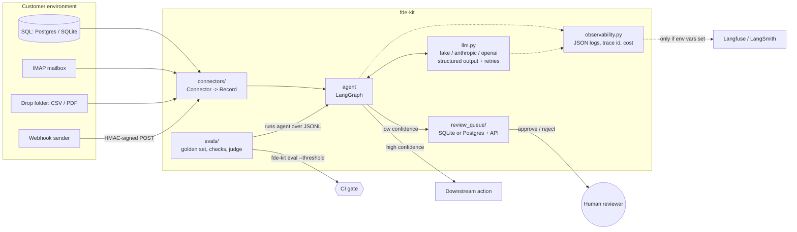

# fde-agent-kit

[](https://github.com/cmzaia/fde-agent-kit/actions/workflows/ci.yml)

**Live demo: https://fde-agent-kit.vercel.app**

A reusable kit for dropping an LLM agent into a customer environment: **connectors** to pull data
in, an **eval gate** that decides whether the agent is good enough to ship, **observability** that
tells you what a run cost and why it did what it did, and a **human review queue** for the cases
the agent should not decide alone.

Everything here is synthetic. The whole thing runs, tests and evals with no API key, using a
deterministic fake model (`LLM_PROVIDER=fake`).

## The problem

Forward-deployed work looks different on every account, but the scaffolding around the agent
does not. Each deployment ends up re-inventing the same five things under deadline pressure:

1. Getting data out of whatever the customer has (a Postgres replica, a shared mailbox, a folder
   of CSVs and PDFs, a vendor webhook).
2. Proving the agent works, in numbers the customer's domain expert trusts, and keeping it
   provable after every prompt or model change.
3. Knowing what a run did, how long it took and what it cost, when something goes wrong at 2am.
4. Putting a person in the loop for low-confidence decisions without building a UI first.
5. Shipping it: container, config, secrets, runbook, and a checklist for the security review.

This repo is the version of that scaffolding I would want on day one of an engagement. The agent
itself (`examples/hello_agent`) is deliberately tiny; the point is everything around it.

## Architecture



## Quickstart

Needs [uv](https://docs.astral.sh/uv/) (it fetches Python 3.12 for you) and, for the container
path, Docker.

```bash
git clone https://github.com/cmzaia/fde-agent-kit && cd fde-agent-kit

# Tests and the eval gate, no API key needed
uv sync --all-extras
uv run pytest -q
uv run fde-kit eval --golden examples/hello_agent/golden.jsonl --threshold 0.9

# End-to-end demo: SQL connector -> agent -> review queue
uv run fde-kit demo

# The deployed shape: app + Postgres
docker compose up --build
curl localhost:8000/healthz
```

With the stack up, the service exposes `POST /webhook` (HMAC-signed intake) and the review API:

```bash
curl -X POST localhost:8000/review/items -H 'content-type: application/json' \
  -d '{"kind":"ticket_triage","payload":{"text":"refund?"}}'
curl 'localhost:8000/review/items?status=pending'
curl -X POST localhost:8000/review/items/1/approve -H 'content-type: application/json' \
  -d '{"reviewer":"alex","note":"looks right"}'
```

### Using a real model

```bash
cp .env.example .env            # .env is git-ignored
# LLM_PROVIDER=anthropic  (model defaults to claude-sonnet-5-5, key from ANTHROPIC_API_KEY)
# LLM_PROVIDER=openai     (key from OPENAI_API_KEY)
uv run fde-kit demo
```

Providers come from `langchain-anthropic` and `langchain-openai`, installed as extras. The agent
and the eval harness only see a LangChain `BaseChatModel`, so swapping providers is a config change.

## Evals

The harness runs any `dict -> dict` agent over a JSONL golden set (one
`{"id", "input", "expected"}` per line). Deterministic checks are exact matches by default, with
`{"$in": [...]}` and `{"$contains": "..."}` operators. `--judge` adds an LLM grader whose score must
also clear a bar. The CLI exits non-zero below the threshold, which is what CI runs.

```console
$ uv run fde-kit eval --golden examples/hello_agent/golden.jsonl --threshold 0.9
| Metric | Value |
|---|---|
| Accuracy | 91.7% (11/12) |
| Threshold | 90.0% (PASS) |
| Est. cost | $0.0056 |
| Tokens in/out | 900 / 192 |
| Latency p50 | 1.1 ms |
| Latency p95 | 3.9 ms |

| Case | Result | Judge | Latency | Notes |
|---|---|---|---|---|
| t01 | pass | - | 8.1 ms |  |
| ...  |  |  |  |  |
| t12 | FAIL | - | 3.7 ms | category: expected 'access', got 'billing' |
```

`t12` ("finance team cannot log in to download the invoice") is a real ambiguity the keyword-based
fake model gets wrong. It is left in on purpose: a golden set that is always 100% is not telling
you anything. `--json-out report.json` writes the same data as JSON (per-case latency, tokens, cost
and trace id). Costs use an illustrative price table in `observability.py`; override with
`LLM_PRICE_IN_PER_MTOK` / `LLM_PRICE_OUT_PER_MTOK` for the customer's contract.

## Adding a connector

A connector turns one customer system into a stream of `Record`s. Three steps:

```python
# src/fde_kit/connectors/s3.py
from collections.abc import Iterator
from typing import Self

from pydantic_settings import BaseSettings, SettingsConfigDict

from fde_kit.connectors.base import Connector, Record, register


class S3Settings(BaseSettings):
    model_config = SettingsConfigDict(env_prefix="FDE_S3_", env_file=".env", extra="ignore")
    bucket: str = ""
    prefix: str = ""


@register
class S3Connector(Connector):
    name = "s3"

    def __init__(self, settings: S3Settings | None = None):
        self.settings = settings or S3Settings()

    @classmethod
    def from_env(cls) -> Self:
        return cls()

    def fetch(
        self,
    ) -> Iterator[
        Record
    ]: ...  # list objects, yield Record(source=self.name, id=key, payload={...})
```

1. Put config in a `pydantic-settings` class with its own `FDE_<NAME>_` prefix.
2. Subclass `Connector`, decorate with `@register`, implement `from_env` and `fetch` (and `health`
   if the system has a cheap liveness check).
3. Import it in `connectors/__init__.py`, add a test with a fake client (see the IMAP test), and
   list the env vars in `.env.example`.

`build_connector("s3")` then works anywhere, which is how a deployment can pick sources purely
from environment.

## What is in the box

| Path | What it does |
|---|---|
| `src/fde_kit/connectors/` | `Connector`/`Record` contract; SQL (SQLAlchemy, SELECT-only guard), IMAP (read-only `BODY.PEEK`), drop folder (CSV rows, PDF text, archives files), webhook (FastAPI, HMAC verification) |
| `src/fde_kit/llm.py` | Provider factory (fake / anthropic / openai) and `structured_output`: JSON schema in the prompt, validation, error fed back on retry, every attempt cost-accounted |
| `src/fde_kit/evals/` | Golden-set loader, deterministic checks, optional `LLMJudge`, accuracy / cost / p50 / p95, markdown and JSON reports |
| `src/fde_kit/observability.py` | JSON logs, one trace id per run (`trace_run`), token and cost tracking, Langfuse/LangSmith hooks that stay off unless their env vars are set |
| `src/fde_kit/review_queue/` | SQLAlchemy-backed queue (SQLite or Postgres) and a FastAPI router: list, create, approve, reject, optional API key |
| `examples/hello_agent/` | Ticket-triage LangGraph: connector record -> LLM triage -> auto-route or human review |
| `Dockerfile`, `docker-compose.yml`, `.env.example` | Multi-stage, non-root image; app + Postgres |
| `deploy/terraform/` | ECS Fargate skeleton (unvalidated, see its README) |
| `docs/` | `RUNBOOK.md`, `ONBOARDING_CHECKLIST.md` |
| `.github/workflows/ci.yml` | ruff, pytest, eval gate (fake provider, threshold 0.9), `docker compose build` |

## Design decisions

- **Fake model as a first-class provider.** CI, demos and reviewers need to run the full path
  without a key or a bill. The fake is deterministic and token-counted, so cost accounting and the
  eval gate are exercised for real. It can also emit invalid JSON on purpose to test retries.
- **Structured output without provider tool-calling.** `structured_output` uses a JSON schema in
  the prompt plus pydantic validation and an error-feedback retry loop. It is a bit less efficient
  than native tool-calling, but it behaves the same on every provider, which is the point of a kit.
- **Connectors pull, they do not push.** `fetch()` is a plain generator, so the same connector
  works from a cron job, a worker loop or a test. The webhook connector buffers and drains.
- **At-least-once for files, read-only for everything else.** The drop folder archives a file only
  after its records were yielded. IMAP uses `BODY.PEEK` so it never flips unread flags. The SQL
  connector accepts one SELECT/WITH statement, as a second line of defense behind a read-only role.
- **Human review is a queue, not a UI.** SQL table plus four endpoints is enough to plug into a
  customer's existing tooling (or a spreadsheet) on week one.
- **Tracing is opt-in by env var.** Customers decide whether prompts may go to a tracing vendor;
  the default is JSON logs with ids, latency, tokens and cost, and no payloads.
- **Eval gate is a CI exit code.** The threshold is a contract, so it lives where changes are
  blocked, not in a dashboard.

## Limits

- The fake model is keyword rules. Its accuracy says nothing about a real model; it proves the
  plumbing. Run the golden set on the real provider before quoting numbers.
- Webhook events are buffered in memory (bounded), so a crash loses unconsumed events. Put a
  durable queue (SQS, Redis streams) behind it for anything that matters.
- No consumer loop is included: `fetch()` is called by whatever schedules your agent.
- The review queue has no user model beyond an optional shared API key. Put it behind the
  customer's SSO proxy.
- Cost figures use an illustrative price table, not a billing source.
- The Terraform skeleton has not been applied or validated here.
- PDF support is text extraction only (no OCR); IMAP is IMAP-over-TLS only.

## Roadmap

- Durable intake queue and a worker that wires connector -> agent -> review queue.
- Reviewer decisions fed back into the golden set automatically.
- Eval regression diffs between two reports, and per-tag accuracy breakdowns.
- OpenTelemetry export alongside the Langfuse/LangSmith hooks.
- OCR fallback for scanned PDFs; OAuth for mailboxes that disable basic auth.
- Validated Terraform module and a Helm chart.

## Development

```bash
uv run ruff check . && uv run ruff format --check .
uv run pytest -q
```

MIT licensed, see [LICENSE](LICENSE).
